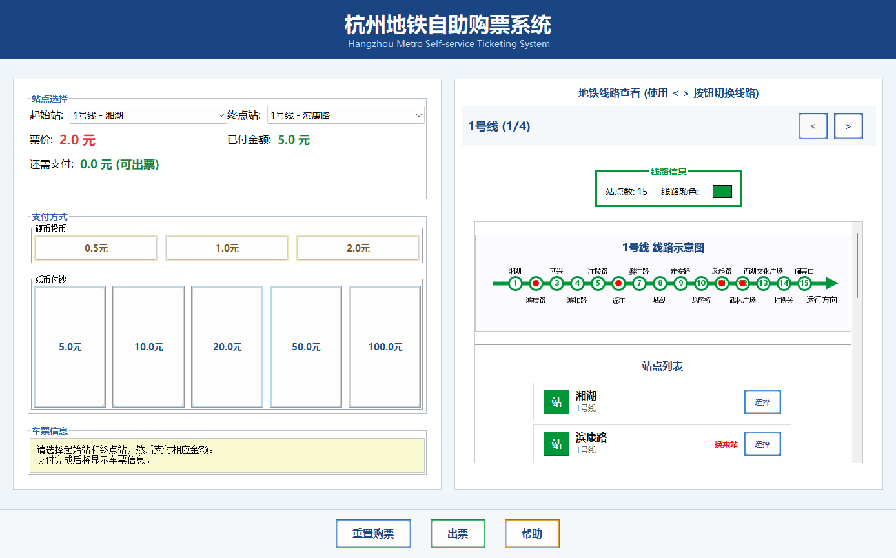

# 杭州地铁自助购票模拟器

用 Java Swing 实现的桌面购票课程设计。通过线路图和站点选择，完成“选站 → 查看票价 → 模拟支付 → 出票找零”的完整交互，适合学习面向对象建模、Java2D 绘制和事件驱动界面。

**JDK 17+ · 无第三方依赖 · 中文界面**

## 界面预览



## 主要功能

- 浏览 1、2、4、5 号线的教学示例站点，以线路颜色区分并标记换乘站。
- 通过下拉框或线路图站点按钮选择起点与终点。
- 实时显示演示票价、已支付金额和待支付余额。
- 模拟投币、付钞、屏幕出票和找零。
- 处理站点未选、同站选择、余额不足、重复出票和交易重置等状态。

## 下载与运行

准备 Git 和 **JDK 17 或更新版本**，确保终端中 `java -version` 与 `javac -version` 均可执行。运行 Swing 界面需要图形桌面，不能直接在纯命令行服务器中显示。

```sh
git clone https://github.com/wqyorxyq/hangzhou-metro-ticket-system.git
cd hangzhou-metro-ticket-system
```

选择与你系统对应的启动方式：

```powershell
# Windows PowerShell
powershell -ExecutionPolicy Bypass -File .\run.ps1
```

```sh
# macOS / Linux（有图形桌面）
sh run.sh
```

启动脚本会创建仓库内的 `out` 目录，编译源码并打开窗口。无需修改脚本中的路径，也无需安装 Maven 或 Gradle。

如需手动编译，在仓库根目录执行（`out` 已存在时跳过创建步骤）：

```sh
mkdir out
javac -encoding UTF-8 --release 17 -d out src/HangzhouMetroTicketSystem.java
java -cp out HangzhouMetroTicketSystem
```

## 用一笔交易熟悉界面

1. 选择起点 `1号线 - 湘湖`、终点 `1号线 - 滨康路`。
2. 确认显示的演示票价为 **2.0 元**。
3. 点击 **5.0 元**付钞按钮，然后点击“出票”。
4. 查看车票信息和 **3.0 元**模拟找零，点击“重置购票”开始下一笔。

## 代码阅读路线

所有类均位于 [`src/HangzhouMetroTicketSystem.java`](src/HangzhouMetroTicketSystem.java)，保留课程设计的单文件组织方式。

| 类 | 职责 |
| --- | --- |
| `MetroStation` | 站点名称、线路、编号与换乘标记 |
| `MetroLine` | 线路信息和有序站点集合 |
| `LineDisplayPanel` | 线路切换、Java2D 图示与站点按钮 |
| `MetroStationClickListener` | 将站点点击事件连接到选择表单 |
| `HangzhouMetroTicketSystem` | 主窗口、票价、支付状态与出票逻辑 |

可从修改示例站点数据、增加票价策略或拆分界面与业务逻辑入手扩展项目。

## 常见问题与范围

- **找不到 `javac`**：请安装完整 JDK，并让终端能够找到其命令；只有 JRE 不足以编译。
- **中文显示不完整**：确保以 UTF-8 编译，并为系统安装可显示中文的字体。界面请求微软雅黑和宋体，缺失时会使用系统替代字体。
- **无法打开窗口**：需要可用的图形桌面；无显示服务的容器或 SSH 会话不适合直接运行。
- **票价并非官方票价**：当前算法使用站点编号差及分段公式，上限 8 元，不计算真实里程或换乘路径。
- **站点表不是完整实时路网**：包含 57 个教学示例站点条目，换乘标记仅用于展示。
- **所有支付与出票均为屏幕模拟**：不接入真实支付、售票机、打印机或交易数据库。

## English overview

A Java Swing metro ticketing simulator with sample line diagrams, station selection, simulated payments, ticket output and change. Requires JDK 17+ and a graphical desktop; no third-party dependencies. Clone the repository and run `run.ps1` on Windows or `sh run.sh` on macOS/Linux. The sample network and fare formula are for coursework, not real journey planning or official fare calculation.
